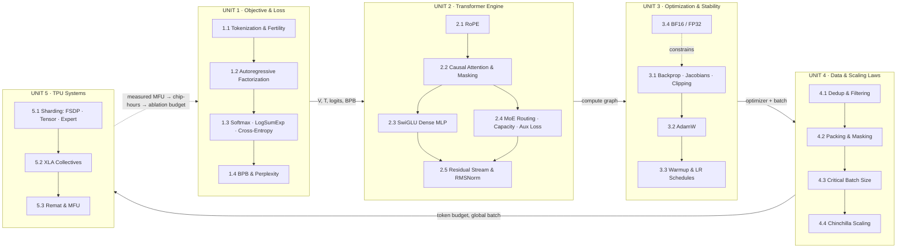

# Master Roadmap

Everything in the book on one page: the map first, then each unit with its chapters, papers, key equations and what you will be able to do afterwards. Tick the boxes as you finish. [← Back to Root Index](../README.md)

**Target:** 2B Dense and 5B MoE (1.4B active) pretraining on TPUs with MaxText / JAX / XLA.

---

## 1. The Map

**One-line story:** define what is being predicted (U1) → build the machine that predicts it (U2) → make it learn without blowing up (U3) → decide what and how much to feed it (U4) → make it run fast on TPUs (U5).

---

## 2. At a Glance

| Unit | Question it answers | Chapters | Papers | You can afterwards… |
|---|---|---|---|---|
| **[1 · Objective & Loss](../unit-01-objective-and-loss/README.md)** | What does the loss curve measure? | 4 | Shannon, Sennrich, ST-MoE | Compare runs across tokenizers via BPB; write a stable loss |
| **[2 · Transformer Engine](../unit-02-transformer-architecture/README.md)** | What happens in one forward pass? | 5 | He, Vaswani, Zhang & Sennrich, Xiong, Shazeer, Su, Switch, ST-MoE | Derive every layer; spot router collapse and token drops |
| **[3 · Optimization & Stability](../unit-03-optimization-and-stability/README.md)** | Why do runs spike or diverge? | 4 | Pascanu, Kingma & Ba, Loshchilov & Hutter, Goyal, Micikevicius | Diagnose spikes from `grad_norm`, `param_norm`, BF16 swamping |
| **[4 · Data & Scaling Laws](../unit-04-data-and-scaling-laws/README.md)** | What to feed, how much, what batch? | 4 | Lee, RefinedWeb, FineWeb, T5, McCandlish, Kaplan, Chinchilla | Size a run from a FLOP budget; pick batch size and token count |
| **[5 · TPU Systems](../unit-05-tpu-systems-and-distributed/README.md)** | Where do the FLOPs go on hardware? | 3 | ZeRO, GSPMD, GShard, Chen, PaLM | Read an XProf trace; raise MFU |

**Totals:** 5 units · 20 chapters · 20 foundational papers (+ MaxText and 8 supplementary) → [READING_LIBRARY.md](../READING_LIBRARY.md)

---

## 3. Suggested Pace

Not a schedule, just a sizing guide: roughly one chapter per study session, with the ablation exercise (§8 of each chapter) done before moving on.

| Phase | Units | Sessions (approx.) | Exit check |
|---|---|---|---|
| Foundations | 1 | 4 | Can convert nats/token to BPB and explain why |
| Architecture | 2 | 5 | Can write the forward pass of both models from memory |
| Dynamics | 3 | 4 | Can predict the effect of changing $\beta_2$, warmup, or clip |
| Data & budget | 4 | 4 | Can size a pilot run and justify the batch size |
| Systems | 5 | 3 | Can compute MFU and name the bottleneck in a trace |
| **Total** | | **≈ 20** | First original, pre-registered ablation |

---

## 4. Unit 1 · The Objective and the Loss

**Goal:** know what the loss curve measures, why tokenizers break raw loss comparisons, and how logits become a stable scalar loss in BF16/FP32.
**Inputs:** raw corpus. **Outputs:** $V$, $T$, loss gradient $\mathbf{p}-\mathbf{y}$, BPB. [Unit README](../unit-01-objective-and-loss/README.md)

| ☐ | Chapter | Key idea / equation | Origin | MaxText spot |
|---|---|---|---|---|
| ☐ | [1.1 Tokenization & Fertility](../unit-01-objective-and-loss/01-tokenization-and-fertility.md) | BPE merges; bytes-per-token; embedding cost $2Vd$ | [Sennrich 2016](https://arxiv.org/abs/1508.07909) | `assets/`, `input_pipeline/` |
| ☐ | [1.2 Autoregressive Factorization](../unit-01-objective-and-loss/02-autoregressive-factorization.md) | $P(\mathbf{x})=\prod_t P(x_t\mid x_{<t})$; shift-by-one | [Shannon 1948](https://ieeexplore.ieee.org/document/6773024) | input/target shift |
| ☐ | [1.3 Softmax, LogSumExp & Cross-Entropy](../unit-01-objective-and-loss/03-softmax-logsumexp-crossentropy.md) | $\ell=\text{LSE}(\mathbf z)-z_y$; $\nabla_{\mathbf z}\ell=\mathbf p-\mathbf y$; Z-loss | [Shannon 1948](https://ieeexplore.ieee.org/document/6773024), [ST-MoE 2022](https://arxiv.org/abs/2202.08906) | `max_utils.py`, `z_loss` |
| ☐ | [1.4 BPB & Perplexity](../unit-01-objective-and-loss/04-bpb-and-perplexity.md) | $\text{BPB}=\frac{\text{nats}}{\ln2\cdot\text{bytes}}$; $\text{PPL}=e^{\ell}$ | [Shannon 1948](https://ieeexplore.ieee.org/document/6773024) | eval loop in `train.py` |

**Deliverable:** a BPB eval that gives the same number for the same text under two tokenizers.
**Failure modes prevented:** tokenizer-confounded ablations, softmax overflow, off-by-one target leakage.

---

## 5. Unit 2 · The Transformer Engine

**Goal:** master the dense and MoE forward pass, why routers collapse or drop tokens, and why pre-norm residuals keep depth trainable.
**Inputs:** $V$, $T$, token IDs. **Outputs:** logits, and the compute graph that Unit 3 differentiates. [Unit README](../unit-02-transformer-architecture/README.md)

| ☐ | Chapter | Key idea / equation | Origin | MaxText spot |
|---|---|---|---|---|
| ☐ | [2.1 RoPE](../unit-02-transformer-architecture/01-rope-positional-embeddings.md) | $\langle R_mq,R_nk\rangle=q^\top R_{n-m}k$; $\theta_i=\theta^{-2i/d_k}$ | [Su 2021](https://arxiv.org/abs/2104.09864) | `layers/embeddings.py` |
| ☐ | [2.2 Causal Attention & Masking](../unit-02-transformer-architecture/02-causal-attention-and-masking.md) | $\text{softmax}(QK^\top/\sqrt{d_k}+M)V$; $O(T^2)$ | [Vaswani 2017](https://arxiv.org/abs/1706.03762) | `layers/attentions.py` |
| ☐ | [2.3 SwiGLU Dense MLP](../unit-02-transformer-architecture/03-swiglu-dense-mlp.md) | $(\text{Swish}(xW_g)\odot xW_u)W_d$; $2/3$ width rule | [Shazeer 2020](https://arxiv.org/abs/2002.05202) | `layers/linears.py` |
| ☐ | [2.4 MoE Routing, Capacity & Aux Loss](../unit-02-transformer-architecture/04-moe-routing-capacity-auxloss.md) | top-$k$ router; capacity; $\alpha E\sum f_iP_i$; router Z-loss | [Switch 2021](https://arxiv.org/abs/2101.03961), [ST-MoE 2022](https://arxiv.org/abs/2202.08906) | `layers/moe.py` |
| ☐ | [2.5 Residual Stream & RMSNorm](../unit-02-transformer-architecture/05-residual-stream-and-rmsnorm.md) | $x_{l+1}=x_l+F(\text{RMSNorm}(x_l))$; identity Jacobian path | [He 2015](https://arxiv.org/abs/1512.03385), [Zhang & Sennrich 2019](https://arxiv.org/abs/1910.07467), [Xiong 2020](https://arxiv.org/abs/2002.04745) | `layers/normalizations.py`, `models.py` |

**Deliverable:** the forward pass of the 2B dense and 5B MoE written out with shapes and parameter counts.
**Failure modes prevented:** mask leakage, router collapse, token dropping, residual blow-up.

---

## 6. Unit 3 · Optimization and Stability

**Goal:** diagnose loss spikes and BF16 problems from gradients, optimizer state, and precision.
**Inputs:** the compute graph. **Outputs:** a stable update rule and a schedule. [Unit README](../unit-03-optimization-and-stability/README.md)

| ☐ | Chapter | Key idea / equation | Origin | MaxText spot |
|---|---|---|---|---|
| ☐ | [3.1 Backprop, Jacobians & Clipping](../unit-03-optimization-and-stability/01-backprop-jacobians-grad-clipping.md) | $\partial x_L/\partial x_l=\prod(I+\partial F/\partial x)$; $\mathbf g\leftarrow\mathbf g\min(1,\tau/\lVert\mathbf g\rVert)$ | [Pascanu 2013](https://arxiv.org/abs/1211.5063) | `train.py`, Optax clip |
| ☐ | [3.2 AdamW](../unit-03-optimization-and-stability/02-adamw-moments-weight-decay.md) | $m_t,v_t$, bias correction, decoupled decay $\lambda$ | [Kingma & Ba 2014](https://arxiv.org/abs/1412.6980), [Loshchilov & Hutter 2019](https://arxiv.org/abs/1711.05101) | `optimizers.py` |
| ☐ | [3.3 Warmup & LR Schedules](../unit-03-optimization-and-stability/03-warmup-and-lr-schedules.md) | linear warmup; cosine / WSD; horizon = token budget | [Goyal 2017](https://arxiv.org/abs/1706.02677), [Hoffmann 2022](https://arxiv.org/abs/2203.15556) | `create_learning_rate_schedule` |
| ☐ | [3.4 Mixed Precision BF16/FP32](../unit-03-optimization-and-stability/04-mixed-precision-bf16-fp32.md) | $\epsilon_{\text{bf16}}=2^{-7}$; swamping $\lvert\Delta\rvert<\tfrac12\epsilon\lvert w\rvert$ | [Micikevicius 2018](https://arxiv.org/abs/1710.03740) | `dtype`, `weight_dtype` |

**Deliverable:** a one-page spike post-mortem using the [debugging tree](../templates/DEBUGGING_DECISION_TREE.md).
**Failure modes prevented:** spikes from large $\beta_2$, early divergence, silently lost BF16 updates.

---

## 7. Unit 4 · Data and Scaling Laws

**Goal:** treat data, packing, batch size and compute budget as optimization problems.
**Inputs:** optimizer behavior, BPB. **Outputs:** token budget $D$ and global batch. [Unit README](../unit-04-data-and-scaling-laws/README.md)

| ☐ | Chapter | Key idea / equation | Origin | MaxText spot |
|---|---|---|---|---|
| ☐ | [4.1 Dedup & Filtering](../unit-04-data-and-scaling-laws/01-deduplication-and-filtering.md) | MinHash $\Pr=J(A,B)$; LSH $1-(1-s^r)^b$ | [Lee 2022](https://arxiv.org/abs/2107.06499), [RefinedWeb 2023](https://arxiv.org/abs/2306.01116), [FineWeb 2024](https://arxiv.org/abs/2406.17557) | offline pipeline |
| ☐ | [4.2 Packing & Masking](../unit-04-data-and-scaling-laws/02-sequence-packing-and-masking.md) | segment mask $\text{seg}_i=\text{seg}_j$; position reset | [T5 2020](https://arxiv.org/abs/1910.10683) | `_grain_data_processing.py` |
| ☐ | [4.3 Critical Batch Size](../unit-04-data-and-scaling-laws/03-critical-batch-size-noise-scale.md) | $B_{\text{noise}}=\text{tr}(\Sigma)/\lVert G\rVert^2$ | [McCandlish 2018](https://arxiv.org/abs/1812.06162) | batch config |
| ☐ | [4.4 Chinchilla Scaling](../unit-04-data-and-scaling-laws/04-chinchilla-scaling-laws.md) | $C\approx6ND$; $L=E+A/N^\alpha+B/D^\beta$; ≈20 tokens/param | [Kaplan 2020](https://arxiv.org/abs/2001.08361), [Hoffmann 2022](https://arxiv.org/abs/2203.15556) | planning |

**Deliverable:** a compute plan: $N_{\text{active}}$, $D$, $C$, global batch, schedule horizon for each model.
**Failure modes prevented:** duplicate-driven memorization, padding waste, over/under-sized batch, wrong $N$/$D$ split.

---

## 8. Unit 5 · TPU Systems and Distributed Training

**Goal:** map math to meshes, know which collective XLA inserts and when, and raise MFU.
**Inputs:** layer shapes, optimizer state, batch and token budget. **Outputs:** step time, MFU, chip-hours. [Unit README](../unit-05-tpu-systems-and-distributed/README.md)

| ☐ | Chapter | Key idea / equation | Origin | MaxText spot |
|---|---|---|---|---|
| ☐ | [5.1 Sharding: FSDP · Tensor · Expert](../unit-05-tpu-systems-and-distributed/01-sharding-mesh-fsdp-tensor-expert.md) | 16 B/param state; per-chip $\approx16N/n$ | [ZeRO 2020](https://arxiv.org/abs/1910.02054), [GSPMD 2021](https://arxiv.org/abs/2105.04663) | `mesh_axes`, `ici_*_parallelism` |
| ☐ | [5.2 XLA Collectives](../unit-05-tpu-systems-and-distributed/02-xla-collectives-communication.md) | All-Gather, Reduce-Scatter, All-to-All; overlap condition | [GShard 2020](https://arxiv.org/abs/2006.16668) | XLA GSPMD, XProf |
| ☐ | [5.3 Remat & MFU](../unit-05-tpu-systems-and-distributed/03-remat-checkpointing-and-mfu.md) | $O(\sqrt L)$ activation memory; MFU = achieved ÷ peak | [Chen 2016](https://arxiv.org/abs/1604.06174), [PaLM 2022](https://arxiv.org/abs/2204.02311) | `remat_policy` |

**Deliverable:** an annotated XProf trace and an MFU number you can defend.
**Failure modes prevented:** OOM from optimizer state, exposed collectives, MoE All-to-All bottleneck, wasted recompute.

---

## 9. Where the Tools Live

| Tool | Use it when | Link |
|---|---|---|
| Experiment log | Before every run: hypothesis, single variable, invariants, promotion rule | [EXPERIMENT_LOG_TEMPLATE.md](../templates/EXPERIMENT_LOG_TEMPLATE.md) |
| Debugging tree | A run spikes, NaNs, collapses, or is slow | [DEBUGGING_DECISION_TREE.md](../templates/DEBUGGING_DECISION_TREE.md) |
| Glossary | You forget a symbol or metric | [GLOSSARY.md](../GLOSSARY.md) |
| Reading library | You want the paper behind a claim | [READING_LIBRARY.md](../READING_LIBRARY.md) |

## 10. Final Milestone

☐ One original ablation on the 2B dense or 5B MoE, pre-registered with the experiment template, predicted before running, and decided by the promotion rule.
