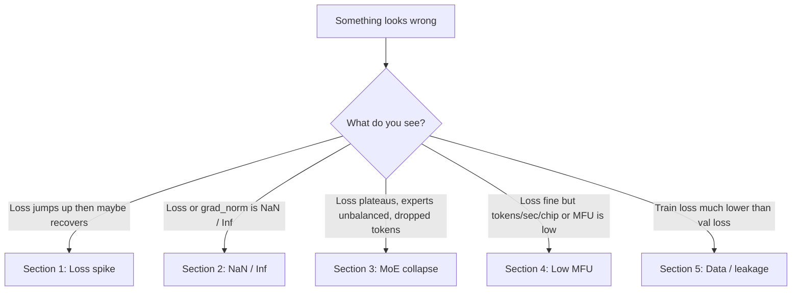
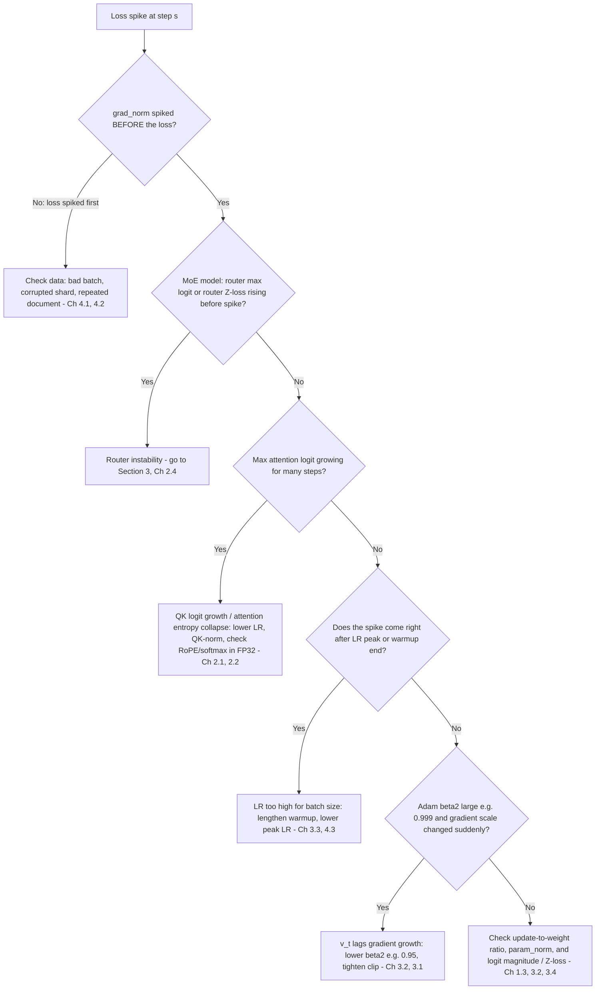
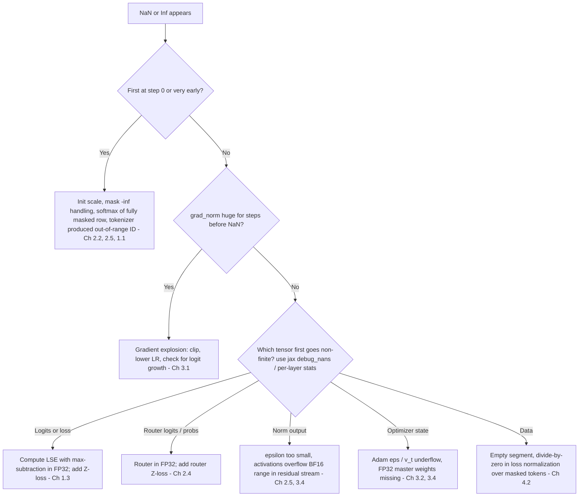
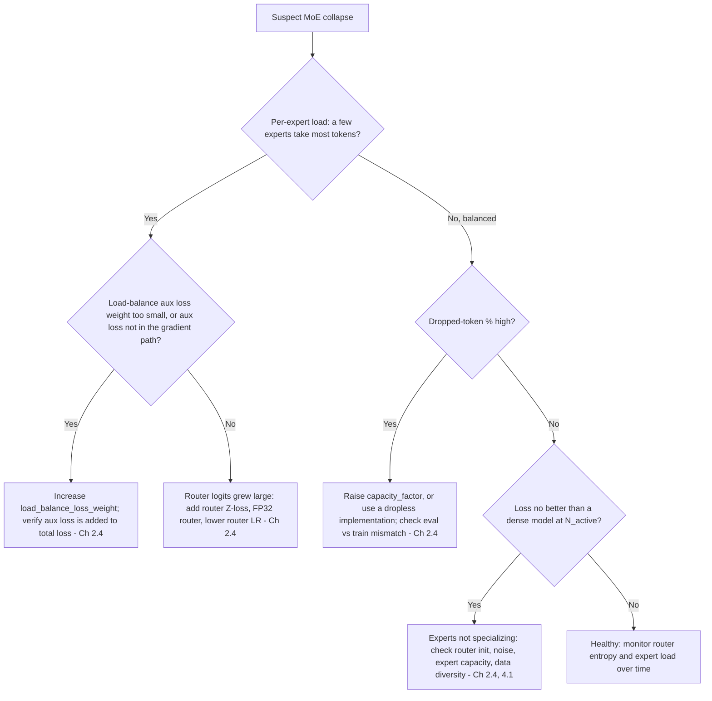
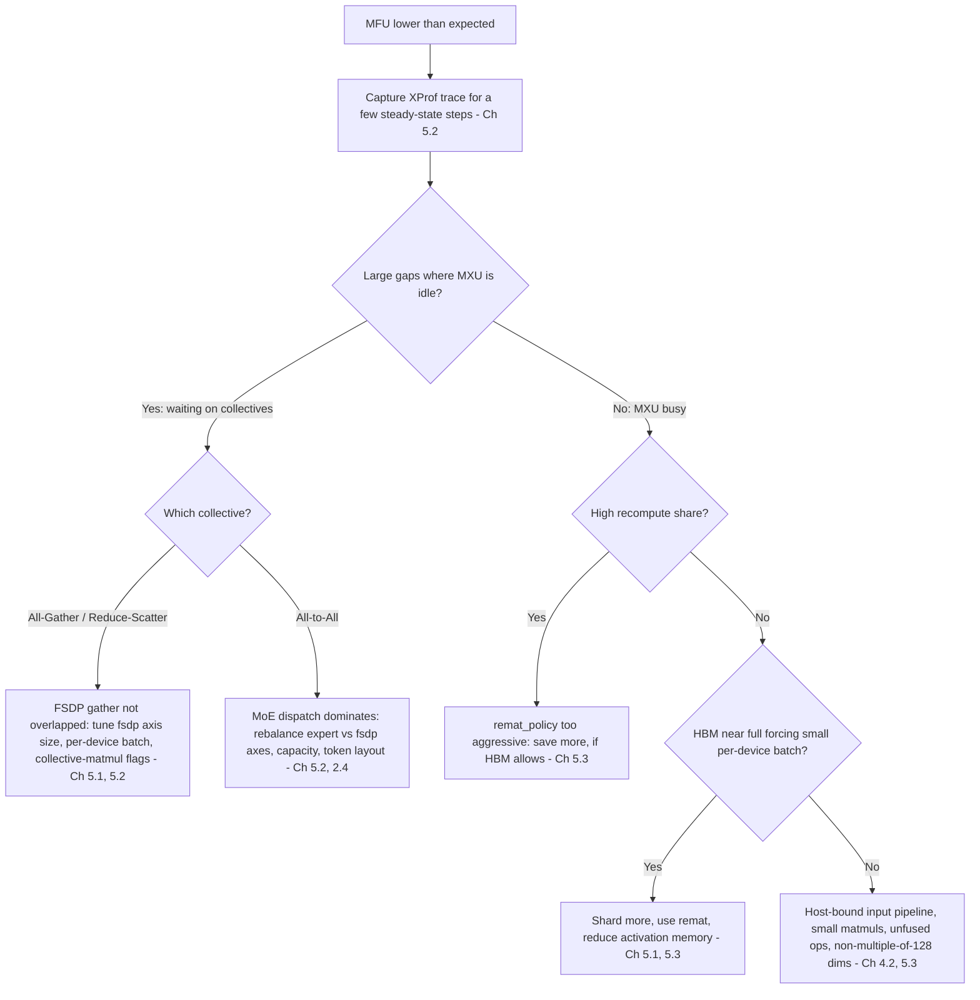

# Debugging Decision Tree

Diagnostic flowcharts for the four failure families of a 2B Dense / 5B MoE pretraining run on TPU: **loss spikes, NaNs/Infs, MoE collapse, and low MFU**. Each branch points to the chapter that explains the mechanism. The hypotheses are *ordered by prior likelihood and cost to check*, not guaranteed; always confirm with the logged metric before changing anything. [← Back to Root Index](../README.md)

> **Rule:** change one thing at a time, log it with the [experiment template](EXPERIMENT_LOG_TEMPLATE.md), and restart from the last healthy checkpoint rather than patching a corrupted optimizer state.

## 0. Triage

## 1. Loss Spike

**Actions to try, in order:** (1) skip or re-shuffle the offending batch range and resume from the pre-spike checkpoint; (2) lower clip threshold; (3) lower $\beta_2$; (4) add/raise Z-loss ([1.3](../unit-01-objective-and-loss/03-softmax-logsumexp-crossentropy.md)); (5) lower peak LR.

## 2. NaN / Inf

**Tip:** BF16 has FP32's exponent range, so overflow is rarer than in FP16, but BF16's ~3-digit precision causes *swamping* (small updates lost) and loss of accuracy in large reductions; check accumulations are FP32.

## 3. MoE Collapse (Router / Expert Imbalance)

## 4. Low MFU / Low Throughput

**Reminder:** MFU counts only useful model FLOPs ([PaLM](https://arxiv.org/abs/2204.02311)); remat raises hardware utilization but not MFU.

## 5. Train/Validation Gap or Suspiciously Good Loss

| Symptom | Likely cause | Check |
|---|---|---|
| Train loss ≪ val loss early | Duplicates between shards, memorization | [4.1](../unit-04-data-and-scaling-laws/01-deduplication-and-filtering.md) |
| Loss far below any plausible value | Target leakage: off-by-one shift or missing causal/segment mask | [1.2](../unit-01-objective-and-loss/02-autoregressive-factorization.md), [2.2](../unit-02-transformer-architecture/02-causal-attention-and-masking.md) |
| Run A "beats" run B but tokenizers differ | Per-token loss comparison | [1.4](../unit-01-objective-and-loss/04-bpb-and-perplexity.md) |
| Val BPB plateau while train falls | Overfitting, multi-epoch repetition | [4.4](../unit-04-data-and-scaling-laws/04-chinchilla-scaling-laws.md) |
